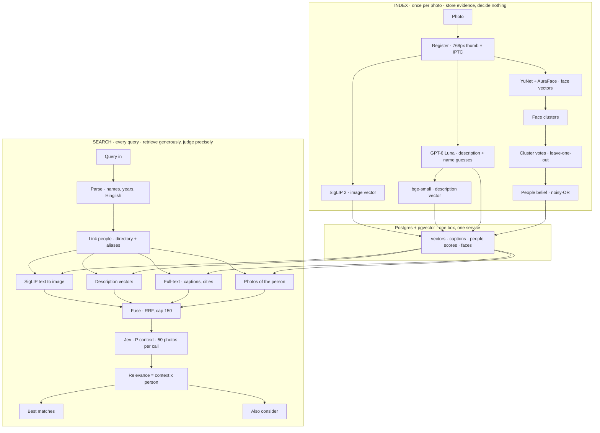

# Photo desk search

Natural-language search over a **newsroom photo archive**. A journalist types a sentence — *modi in pink jacket*, *farmers protesting on a highway* — and gets relevant photos, their metadata, and a result in about a second.

This repo is the code, the architecture, and the measured findings. It is **not affiliated with any news organisation**. Archive photos, captions, embeddings, API keys, and judged caches are not included. Bring your own images.

Target: cheap, fast, accurate. Search under 1 s. One Postgres box, one Python service.

## A different architecture

Typical photo search does one of two things: tag each image once (VLM → keywords → full-text), or embed it once (CLIP/SigLIP → nearest neighbours). Both fail on a news archive. A one-shot tag throws a name away if it misses a 0.5 bar. “Looks like” is not “satisfies the query” — *flood* returns calm water. Scores from different retrievers cannot be compared, so fusion becomes a pile of cutoffs.

This system splits the job:

1. **Index stores evidence and decides nothing.** Description, name guesses, image vector, description vector, faces — all kept. A weak Luna name is still evidence for later.
2. **Corpus jobs accumulate people.** Face clusters vote leave-one-out across photos. Belief is noisy-OR of independent sources (caption, faces, other photos’ votes). A guess never confirms itself.
3. **Query retrieves generously, then judges precisely.** Four recall sources (SigLIP, meaning, full-text, people) fuse with RRF. Stage 2 is a real relevance model: **P(context) × P(people)**. Two tiers, not one cutoff. Uncertain names show as “possible” instead of disappearing.

Dates never come from a model. Captions are evidence, like the Luna description — not ground truth.



Animated version of the same pipeline (open the HTML file in a browser): [docs/architecture_explainer.html](docs/architecture_explainer.html). Decision log: [PLAN.md](PLAN.md). Experiment log: [EXPERIMENTS.md](EXPERIMENTS.md).

| Piece | Choice | Licence |
|---|---|---|
| Image/text embedding | `google/siglip2-base-patch16-256` | Apache-2.0 |
| Face detection | OpenCV YuNet | MIT |
| Face recognition | AuraFace v1 | Apache-2.0 |
| Description | `gpt-6-luna` via OpenAI API (swappable in `app/vlm.py`) | API |
| Stage 2 | Jev (TypeSafe) or MiniLM cross-encoder | API / Apache-2.0 |
| Store | Postgres 17 + pgvector (Docker) | — |

## Results

Measured on a **private** news archive (photos not in this repo). Judge: GPT-6 Luna, names judged blind. Human check of 300 pairs: 85% agreement on relevant yes/no.

**33,759 photos, 198 queries** (after judge fixes; both tiers ≥ 0.1 unless noted):

| | P@10 | R@pool | empty | junk/q | hit@1 | hit@10 |
|---|---|---|---|---|---|---|
| 5,002 photos | 0.78 [0.74–0.82] | 0.90 | 6 | 0.15 | 0.70 | 0.92 |
| 33,759 photos | 0.78 / 0.83 top tier | 0.87 | 5 | 0.15 | 0.57 | 0.79 |

Precision held at 6.7× the data. Known-item rank fell because the bigger set holds several equally valid photos per query. Live latency ~0.8–1.2 s warm; uncached 1.4–1.7 s (parse + Jev).

**Stage 2 (5,002 photos):** batched Jev (50 docs/call, threshold 0.2) beat MiniLM on precision and junk while staying under 1 s.

| stage 2 | P@10 | R@pool | empty | junk/q | hit@10 | p50 |
|---|---|---|---|---|---|---|
| MiniLM @ 0.5 | 0.55 | 0.61 | 9 | 0.53 | 0.84 | 746 ms |
| Jev batched @ 0.2 | 0.64 | 0.70 | 6 | 0.26 | 0.88 | 811 ms |

After linker / fusion / two-tier fixes on the 5k set: P@10 0.78, hit@10 0.92, never-retrieved 7 of 198.

**Newsroom queries** (40 sentences written the way reporters ask, 33k index): both tiers P@10 0.75, top tier 0.84, junk near zero. Weak queries are “right topic, not the exact scene,” not noise.

Any single retriever alone sits around P@10 0.50–0.63. The hybrid is the point.

## Cost

| Item | 50k images | 10M images |
|---|---|---|
| Luna descriptions (Batch API) | ~$10 | ~$2–3.5k |
| Luna realtime | ~$0.35 / 1k | — |
| SigLIP + faces (rented GPU) | ~$2 | ~$100–200 |
| Jev stage 2 | ~$0.0017 / query at 150 candidates | — |
| Serving | one Postgres box | same, or ~$200/mo cloud |

Batch API halved Luna from $0.40/1k to **$0.20/1k** (28,757 photos for $5.70). Compact schema $0.24/1k. A 3.4 h GPU experiment job was ≈$5.

Self-hosted Qwen3-VL is the production candidate if sending thumbnails to an API is not allowed; it has to win on `eval/`, not on a blog post.

## What we tried and dropped

Keep what beats the same table (P@10, R@pool, empty, junk/q, latency). Details in [EXPERIMENTS.md](EXPERIMENTS.md).

| | Verdict |
|---|---|
| Captions in full-text, description vector, reranker doc | **Adopt** |
| Names from captions + cluster votes | **Adopt** |
| Cached LLM query parse (names, years, Hinglish; city as boost only) | **Adopt** |
| Jev as stage 2, 50 docs/call | **Adopt** |
| Cap a Luna-only person tag at 0.75 (“possible”) | **Adopt** — Luna confidence is not calibrated |
| Caption-aware Luna (describe *with* the caption) | Drop — wash vs image-only once caption names are in |
| Closed-vocab taxonomy prompt | Drop — labels accurate, search did not improve |
| Learned fusion / LightGBM | Drop — no clear change |
| Near-dup collapse | Drop on a 10% sample (0.1% dups) |
| Dense extra description for stage 2 | Drop — slightly worse |
| Bigger image model (siglip2-so400m) | Candidate later; 4-source recall is already ~0.9 |

## Run it on your photos

No sample images are shipped.

```bash
cp .env.example .env            # add OPENAI_API_KEY; JEV_API_KEY if using jev
docker compose up -d            # Postgres + pgvector on :5433
uv sync

mkdir -p data/photos
# copy JPEGs / PNGs / PDFs into data/photos

uv run python -m app.ingest --dir data/photos
uv run uvicorn app.api:app --port 8000
# http://localhost:8000  reporter UI
# /debug                 testing UI
# ?debug=1               scores, why-matched, face boxes
```

Without an API key: `--steps register,embed,faces,people`. Search then works from embeddings.

Ingest steps are idempotent. Re-run any step with `--steps`. Face gallery seeding from Wikidata is optional: `uv run python -m app.gallery --no-bulk`.

Eval (needs your index; judged caches are not published, so a scored run needs an API key to rebuild them):

```bash
uv run python -m eval.run_eval --types newsroom --show-misses
```

Queries we used: [eval/hand_queries.txt](eval/hand_queries.txt).

## Layout

```
app/           ingest, search, VLM, faces, FastAPI + static UI
eval/          queries, reports, harness (run_eval, judge)
exp/           experiment runners + results.md (no embeddings or photo dumps)
PLAN.md        architecture, costs, open questions
EXPERIMENTS.md measured adopt / drop log
```

## Licence

MIT for this repo. Third-party models keep their own licences (table above). InsightFace default weights are **not** used here because they are non-commercial unless licensed; AuraFace is Apache-2.0.
